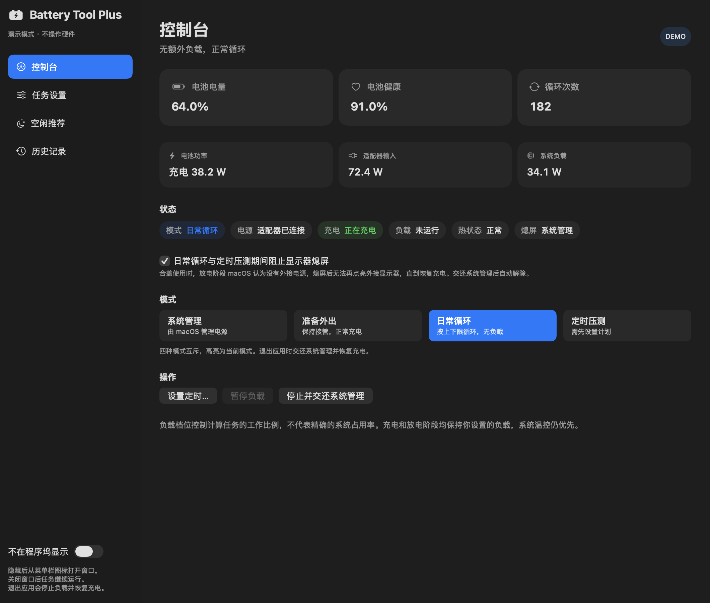

# Battery Tool Plus

[](https://github.com/hcy2206/battery-tool-plus/releases)
[](https://github.com/hcy2206/battery-tool-plus/releases)
[](https://github.com/hcy2206/battery-tool-plus/releases/latest)
[](LICENSE)

**让 MacBook 自己完成电池循环。**
Battery Tool Plus 是一个 Apple Silicon MacBook 的原生 macOS 应用：插着电源，它就能在你设定的电量区间内自动充放电，
按需叠加 CPU / GPU 负载加速消耗，在你不用电脑的时段自动跑、你一坐下就让路，并把整个过程记录下来。
它建立在 [Orest Tokovenko 的 BatteryTool](https://github.com/oresttokovenko/battery-tool) 命令行工具之上
（[项目背景](https://oresttokovenko.com/blog/macbook-battery-replacement/)），补上了图形界面、负载、定时与学习能力。



## 它能做什么

- **自动循环。** 在电量上下限之间反复充放电，达到目标健康度自动停止。不用拔线，也不用守着。
- **可控负载。** 定时压测时按档位运行 CPU 和 Metal GPU 计算负载，让放电阶段真正“耗电”，而不是空等。
- **定时与截止。** 给任务一个窗口：到点要用电脑，就提前停负载转为日常循环；到点要带走电脑，就按历史充电速度倒推，提前把电充满。
- **空闲推荐。** 开启本地记录后，应用从你的作息里学习空闲时段，推荐任务窗口；是否启动始终由你确认。
- **实时读数与历史。** 电量、健康度、循环次数、电池 / 适配器 / 系统功率，24 小时电量曲线与操作事件；可选 PushDeer 推送需要你介入的情况。
- **菜单栏常驻。** 关窗不停任务，可隐藏 Dock 图标，从菜单栏随时切换模式。

## 四种模式

| 模式 | 你想做的事 | 应用的行为 |
| --- | --- | --- |
| 系统管理 | 什么都不改 | 交还 macOS，正常充电（默认） |
| 准备外出 | 一会儿要带走电脑 | 停止负载和放电，恢复正常充电，直到你切换 |
| 日常循环 | 安静地循环 | 在上下限之间充放电，不运行负载 |
| 定时压测 | 在空闲时段里加速 | 确认的时间窗内循环，并运行设定的 CPU / GPU 负载 |

## 它会替你注意什么

- **你在用电脑就让路。** 检测到键鼠活动时暂停负载，持续空闲后自动恢复（可关闭）。
- **温度优先。** 系统热状态升高时自动降载或暂停，macOS 的温控永远优先。
- **安全兜底。** 拔掉电源、读数异常、电量过低、电源写入失败或退出应用时，都会立刻停止负载并恢复充电。
- **合盖放电也能推进。** 放电阶段自动处理 macOS 的合盖睡眠与外接显示器熄屏问题，恢复充电后再交还系统。
- **最小权限。** 图形应用以普通用户运行；电池控制由一个按需授权、只接受固定几条命令的短生命周期服务完成，与命令行工具共享同一把互斥锁。

## 安装

1. 从 [Releases](https://github.com/hcy2206/battery-tool-plus/releases/latest) 下载 `BatteryToolPlus-<版本>-macos-arm64.dmg`。
2. 双击挂载，把 `Battery Tool Plus.app` 拖到旁边的 Applications 快捷方式上。
3. 首次打开时 macOS 会提示无法验证开发者：打开“系统设置 → 隐私与安全性”，在页面底部点“仍要打开”（[Apple 说明](https://support.apple.com/102445)）。

应用使用 ad-hoc 签名，无需安装 Python 或 Xcode。打开后点击“授权电池控制”完成一次管理员授权，接着选择模式或设置定时即可。

**要求：** Apple Silicon，macOS 15 或更高版本。充电控制依赖固件暴露的 SMC 键，应用会自动探测；
macOS 15、26 与 27（含 15.8 / 26.7 更新后的固件）均已覆盖，差异见[使用指南](docs/USER_GUIDE.md#系统与固件支持)。

### 从源码构建

```bash
git clone https://github.com/hcy2206/battery-tool-plus.git
cd battery-tool-plus
./scripts/build-macos.sh
open "dist/Battery Tool Plus.app"            # 加 --args --demo 可只看界面，不碰硬件
```

### 命令行

上游的 Python CLI 保留在仓库中，适合脚本与无界面场景：

```bash
uv tool install --python 3.12 --no-config .
sudo "$(command -v battery-tool)" --max-charge 95 --min-charge 5 --target-health 79
```

## 文档

- [使用指南](docs/USER_GUIDE.md) — 安装、模式、定时、负载与温控、睡眠处理、固件支持、命令行参数
- [开发指南](docs/CONTRIBUTING.md) — 环境、检查命令、代码结构、模拟后端
- [发布指南](docs/RELEASING.md) — 版本、打包、签名与 GitHub Release
- [变更记录](docs/CHANGELOG.md) · [第三方声明](docs/THIRD_PARTY_NOTICES.md)

## 许可与致谢

按 **GPL-3.0-only** 分发（[LICENSE](LICENSE)）。上游 Apache-2.0 许可原文保存在 [LICENSES/Apache-2.0.txt](LICENSES/Apache-2.0.txt)，
SMC 文件保留 GPL-2.0-or-later 声明，详见[第三方声明](docs/THIRD_PARTY_NOTICES.md)。

- [BatteryTool](https://github.com/oresttokovenko/battery-tool) — [Orest Tokovenko](https://github.com/oresttokovenko)
- [battery.sh](https://github.com/actuallymentor/battery/blob/main/battery.sh) — [Actually Mentor](https://github.com/actuallymentor)
- [smc-command](https://github.com/hholtmann/smcFanControl/tree/master/smc-command) — [hholtmann](https://github.com/hholtmann)
- [bclm](https://github.com/zackelia/bclm) — 充电控制 SMC 键的研究参考
